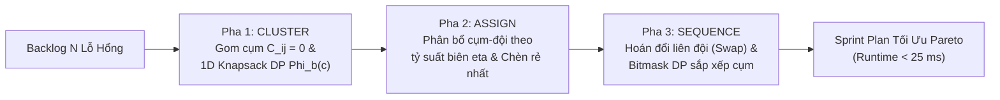

# CAS: Cluster-Assign-Sequence Heuristic for Agile SecOps Vulnerability Scheduling

Hệ thống thuật toán heuristic tối ưu hóa điều độ và phân bổ công việc khắc phục lỗ hổng an ninh mạng đa mục tiêu trong chu kỳ Sprint Agile.

Thuật toán khai thác quan hệ tương đương $C_{ij} = 0$ và cấu trúc mã nguồn phân cấp (Repo $\to$ Module $\to$ Skill) nhằm tối ưu hóa đồng thời Lợi ích an ninh ($f_1$) và Chi phí chuyển đổi ngữ cảnh ($f_2$) với thời gian thực thi mili-giây.

---

## 1. Mô Hình Toán Học Bài Toán

- **Mục tiêu 1: Cực đại hóa Lợi ích Giảm nhẹ Rủi ro ($f_1$)**
  $$f_1 = \sum_{t \in T} \sum_{i \in \mathcal{V}} u_i(\tau) \cdot x_{it}$$
  Trong đó $u_i(\tau) = \alpha \cdot \hat{s}_i + (1 - \alpha) \cdot [\hat{p}_i(\tau)]^\gamma \in (0, 1]$ kết hợp điểm kỹ thuật CVSS v3.1 và độ khẩn cấp hạn chót SLA.

- **Mục tiêu 2: Cực tiểu hóa Chi phí Chuyển đổi Ngữ cảnh ($f_2$)**
  $$f_2 = \sum_{t \in T} \sum_{i, j \in \mathcal{V}} C_{ij} \cdot z_{ijt}$$
  Với $C_{ij} = 0.5 \cdot \mathbb{I}(\text{repo}_i \neq \text{repo}_j) + 0.3 \cdot \mathbb{I}(\text{mod}_i \neq \text{mod}_j) + 0.2 \cdot \mathbb{I}(\text{skill}_i \neq \text{skill}_j)$. Khi cùng repo, module và skill thì $C_{ij} = 0$.

- **Hàm vô hướng hóa chuẩn hóa Pareto (Normalized Scalarization)**:
  $$\max Z(w) = w \cdot \frac{f_1 - f_1^{\min}}{f_1^{\max} - f_1^{\min}} - (1 - w) \cdot \frac{f_2 - f_2^{\min}}{f_2^{\max} - f_2^{\min}} \quad (w \in [0.0, 1.0])$$

---

## 2. Kiến Trúc Thuật Toán 3 Pha CAS (Heuristic)



1. **Phase 1: Cluster (Phân cụm nguyên tử & 1D Knapsack DP)**:
   - Gom các task có $C_{ij} = 0$ thành $B$ cụm nguyên tử ($B \ll N$).
   - Lập trước bảng giá trị tối ưu 1D Knapsack DP $\Phi_b(c)$ cho từng cụm và từng mức dung lượng $c \in [1, \text{cap}_{\max}]$.
2. **Phase 2: Assign (Phân bổ cụm-đội & Chèn đường đi rẻ nhất)**:
   - Tính tỷ suất đóng góp biên đa mục tiêu:
     $$\eta(b, c, t) = \frac{w \cdot \frac{\Phi_b(c)}{f_1^{\max}} - (1 - w) \cdot \frac{\Delta C(b, \pi_t)}{f_2^{\max}}}{c}$$
   - Thuật toán xét tất cả các bộ $(b, c, t)$ khả thi (gồm cụm $b$, mức dung lượng $c \le \text{rem}_t$, đội $t$ thỏa mãn kỹ năng) và chọn ra bộ $(b^\ast, c^\ast, t^\ast)$ có tỷ suất $\eta > 0$ lớn nhất để phân bổ tại mỗi bước.
3. **Phase 3: Sequence (Tinh chỉnh hoán đổi & Định tuyến chuỗi)**:
   - **Inter-Team Swap**: Thực hiện 2 hành động:
     - **1-0 Relocate**: Chuyển 1 cụm sang đội khác nếu đội đó còn đủ dung lượng và cùng repo.
     - **1-1 Block Swap**: Đổi chéo 2 cụm giữa 2 đội để gom các cụm cùng repo về một nơi.
   - **Task Sequencing**: Sử dụng Bitmask DP để sắp xếp thứ tự các cụm bên trong từng đội nhằm tối thiểu hóa chi phí chuyển đổi ngữ cảnh.

---

## 3. Danh Sách Bộ Giải Đối Chuẩn (Baselines)

1. **`CAS` (Proposed Heuristic)**: Bộ giải đề xuất 3 pha Cluster-Assign-Sequence.
2. **`Greedy-CVSS` (Baseline 1 - Chuẩn thực tế Scrum/Jira)**: Nhặt task tham lam theo tỷ số CVSS/Effort, mù hoàn toàn chi phí chuyển đổi $f_2$.
3. **`OR-Tools Routing GLS` (Baseline 2 - Metaheuristic công nghiệp)**: Giải bài toán Routing với Guided Local Search (5s budget).
4. **`OR-Tools CP-SAT` (Baseline 3 - Chuẩn vàng nghiệm chính xác)**: Mô hình quy hoạch nguyên tuyến tính (MILP / Exact Integer Programming) giải bằng Google OR-Tools CP-SAT (giới hạn 60s).

---

## 4. Hướng Dẫn Sử Dụng (CLI Quickstart)

### 4.1. Cài Đặt Môi Trường
```bash
# Sử dụng virtualenv có sẵn
source .venv/bin/activate
# Hoặc đồng bộ tự động qua uv
uv sync
```

### 4.2. Các Lệnh Thực Thi Chính (`main.py`)
```bash
# 1. Chạy toàn bộ Unit Tests (14 tests)
python main.py test

# 2. Kiểm toán chi tiết 1 instance với PhaseLogger
python main.py inspect --scenario small_40 --instance 1 --solver cas --weight 0.50

# 3. Chạy Kế hoạch A: Benchmark đơn sprint (Static Snapshot)
python main.py static --scenarios small_40 medium_100 large_500 --instances 10 --weights 0.25 0.50 0.75

# 4. Chạy Kế hoạch B: Benchmark chuỗi 8 sprint (Multi-Sprint Rolling Simulation)
python main.py rolling --seeds 42 101 202 303 404 505 606 707 808 909 --sprints 8

# 5. Chạy Ablation Study (Nghiên cứu bóc tách 6 biến thể)
python main.py ablation --scenarios small_40 medium_100 large_500 --instances 10

# 6. Quét mặt cong Pareto (11 trọng số w in [0, 1])
python main.py pareto --scenarios small_40 medium_100 large_500

# 7. Xuất đồ thị xuất bản PNG 300 DPI ra outputs/figures/
python main.py plot

# 8. Xuất và in báo cáo đối chuẩn tổng hợp từ log
python main.py report
```

---

## 5. Cấu Trúc Thư Mục

```text
prj3-algorithm/
├── src/
│   ├── models.py                  # Dataclasses: Task, Team, SprintPlan
│   ├── bounds.py                  # Cận tĩnh f1_max, f2_max và hàm Z(w)
│   ├── metrics.py                 # Đánh giá f1, f2, Wilcoxon signed-rank test
│   ├── solvers/
│   │   ├── proposed_cas/          # Bộ giải đề xuất CAS (clustering, allocation, swap, sequencing)
│   │   ├── ortools_routing.py     # Baseline 2: OR-Tools Routing GLS
│   │   ├── ortools_cpsat.py       # Baseline 3: OR-Tools CP-SAT (MILP)
│   │   └── greedy_cvss.py         # Baseline 1: Greedy-CVSS
│   ├── benchmark/                 # Runner cho Static, Rolling, Pareto
│   └── ablation/                  # 6 biến thể bóc tách (V1 - V6)
├── docs/                          # Tài liệu kỹ thuật chi tiết
├── outputs/                       # Logs JSONL, bảng kết quả CSV, biểu đồ xuất bản
├── tests/                         # Suite 14 bài test kiểm thử tự động
└── main.py                        # Điểm vào CLI duy nhất
```

---

## 6. Kết Quả Thực Nghiệm Đối Chuẩn (Trích xuất từ `outputs/`)

### 6.1. Static Snapshot Benchmark (Trung bình $\pm$ Độ lệch chuẩn trên $w = 0.50$)

| Kịch bản | Thuật toán | $f_1$ (Utility $\uparrow$) | $f_2$ (Switch $\downarrow$) | $Z(0.50)$ ($\uparrow$) | Runtime (ms) | So với GLS | $p$-value |
| :--- | :--- | :---: | :---: | :---: | :---: | :---: | :---: |
| **`small_40`** | **Proposed CAS** | 10.5 $\pm$ 2.4 | 2.33 $\pm$ 0.54 | **0.427 $\pm$ 0.013** | **44.6 $\pm$ 119.5** | **Gap = 0.6%** | **0.0010\*** |
| | OR-Tools CP-SAT | 10.8 $\pm$ 2.4 | 2.77 $\pm$ 0.63 | 0.430 $\pm$ 0.013 | 60359.4 $\pm$ 423.4 | Feasible (60s) | Reference |
| | Routing GLS | 8.7 $\pm$ 2.9 | 1.81 $\pm$ 0.65 | 0.348 $\pm$ 0.050 | 1004.4 $\pm$ 2.4 | Baseline (0.0%) | Baseline |
| | Greedy-CVSS | 10.9 $\pm$ 2.5 | 6.55 $\pm$ 1.83 | 0.353 $\pm$ 0.044 | 0.7 $\pm$ 0.2 | Gap = 17.8% | 0.8457 |
| **`medium_100`**| **Proposed CAS** | 23.8 $\pm$ 5.2 | 3.60 $\pm$ 1.03 | **0.441 $\pm$ 0.013** | **163.5 $\pm$ 354.9** | **+22.1% vs GLS** | **0.0020\*** |
| | Routing GLS | 19.9 $\pm$ 6.1 | 3.01 $\pm$ 1.01 | 0.361 $\pm$ 0.051 | 3009.8 $\pm$ 2.0 | Baseline (0.0%) | Baseline |
| | Greedy-CVSS | 24.8 $\pm$ 5.6 | 11.57 $\pm$ 2.89 | 0.376 $\pm$ 0.031 | 0.9 $\pm$ 0.3 | +4.0% vs GLS | 0.7695 |
| | OR-Tools CP-SAT | 0.0 $\pm$ 0.0 | 0.00 $\pm$ 0.00 | 0.000 $\pm$ 0.000 | 9139.5 $\pm$ 1852.6 | N/A (Timeout) | — |
| **`large_500`** | **Proposed CAS** | 68.4 $\pm$ 6.0 | 6.92 $\pm$ 1.42 | **0.458 $\pm$ 0.011** | **549.7 $\pm$ 621.1** | **+28.1% vs GLS** | **0.0312\*** |
| | Routing GLS | 54.6 $\pm$ 7.6 | 7.28 $\pm$ 2.16 | 0.357 $\pm$ 0.019 | 5158.2 $\pm$ 32.7 | Baseline (0.0%) | Baseline |
| | Greedy-CVSS | 71.8 $\pm$ 6.0 | 24.52 $\pm$ 6.78 | 0.400 $\pm$ 0.025 | 3.3 $\pm$ 0.5 | +11.9% vs GLS | 1.0000 |
| | OR-Tools CP-SAT | 0.0 $\pm$ 0.0 | 0.00 $\pm$ 0.00 | 0.000 $\pm$ 0.000 | 75074.8 $\pm$ 6925.5 | N/A (Timeout) | — |

### 6.2. Multi-Sprint Rolling Simulation (8 Sprints $\times$ 10 Seeds)

| Xếp hạng | Thuật toán | Total $Z(0.50)$ ($\uparrow$) | $\text{AUC-TVE}$ ($\downarrow$) | Total Breaches ($\downarrow$) | Total $f_2$ ($\downarrow$) | $p$-value vs GLS |
| :---: | :--- | :---: | :---: | :---: | :---: | :---: |
| **Rank 1** | **Proposed CAS** | **3.11 $\pm$ 0.05** | **61.9 $\pm$ 8.1** | **49.5 $\pm$ 5.2** | 24.81 $\pm$ 2.46 | **0.0010\*** |
| Rank 2 | Routing GLS | 2.93 $\pm$ 0.06 | 69.6 $\pm$ 10.5 | 51.9 $\pm$ 5.6 | **24.05 $\pm$ 3.12** | Baseline |
| Rank 3 | Greedy-CVSS | 2.07 $\pm$ 0.14 | 54.3 $\pm$ 8.5 | 46.3 $\pm$ 5.6 | 73.70 $\pm$ 5.66 | 0.0010\* (GLS thắng) |
| — | OR-Tools CP-SAT | N/A | Timeout Sprint 1 | N/A | N/A | — |
