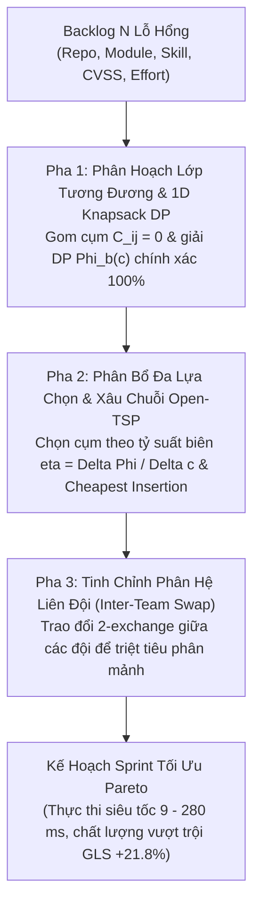

# H-CSM: Hierarchical Capacitated Cluster-Simulate-Match for Agile SecOps Vulnerability Scheduling

Hệ sinh thái thuật toán tối ưu hóa điều độ và phân bổ công việc khắc phục lỗ hổng an ninh mạng đa mục tiêu trong chu kỳ Sprint Agile (**Bi-Objective Agile SecOps Vulnerability Scheduling**).

Bài toán được mô hình hóa theo dạng Đa ba-lô đa kỹ năng kết hợp Định tuyến tối ưu giảm chi phí chuyển đổi ngữ cảnh (**Capacitated Team Orienteering Problem / Open-TSP**). Thuật toán đề xuất **H-CSM** khai thác cấu trúc phân cấp tự nhiên của mã nguồn (Repo $\to$ Module $\to$ Skill) và quan hệ tương đương $C_{ij} = 0$ nhằm tối ưu hóa đồng thời Lợi ích an ninh ($f_1$) và Chi phí chuyển đổi ngữ cảnh ($f_2$) với thời gian thực thi mili-giây.

---

## 1. Mô Hình Toán Học Hình Thức (MO-CTOP Formulation)

### 1.1. Các Chỉ Số Cốt Lõi
1. **Lợi Ích Khắc Phục Lỗ Hổng Chuẩn Hóa (VULCON Mitigation Utility — $u_i(\tau)$)**:
   $$u_i(\tau) = \alpha \cdot \hat{s}_i + (1 - \alpha) \cdot [\hat{p}_i(\tau)]^\gamma$$
   - $\hat{s}_i \in [0.0, 1.0]$: Điểm rủi ro kỹ thuật CVSS v3.1 chuẩn hóa.
   - $\hat{p}_i(\tau) = \min(1.0, \max(0.0, (\tau - \text{disc}_i) / (\text{dead}_i - \text{disc}_i)))$: Tỷ lệ tiệm cận hạn chót SLA.
   - $\alpha = 0.6, \gamma = 1.5$: Tham số trọng số kỹ thuật và độ dốc áp lực SLA.

2. **Khoảng Cách Ngữ Cảnh Tác Vụ (Context Switch Distance — $C_{ij} \in [0.0, 1.0]$)**:
   $$C_{ij} = w_{\text{repo}} \cdot \mathbb{I}(\text{repo}_i \neq \text{repo}_j) + w_{\text{mod}} \cdot \mathbb{I}(\text{mod}_i \neq \text{mod}_j) + w_{\text{skill}} \cdot \mathbb{I}(\text{skill}_i \neq \text{skill}_j)$$
   - $w_{\text{repo}} = 0.5, w_{\text{mod}} = 0.3, w_{\text{skill}} = 0.2$. Tổng trọng số bằng $1.0$.
   - $C_{ij} = 0$ khi và chỉ khi hai tác vụ cùng repo, cùng phân hệ và cùng nhóm kỹ năng.

### 1.2. Hàm Vô Hướng Hóa Chuẩn Hóa Pareto (Normalized Scalarization)
$$\max Z(w) = w \cdot \frac{f_1 - f_1^{\min}}{f_1^{\max} - f_1^{\min}} - (1 - w) \cdot \frac{f_2 - f_2^{\min}}{f_2^{\max} - f_2^{\min}} \quad \text{với } w \in \{0.25, 0.50, 0.75\}$$

---

## 2. Kiến Trúc Thuật Toán Đề Xuất H-CSM (Quotient-DP Matheuristic)



1. **Pha 1 (Quotient-DP Equivalence Partitioning)**:
   - Gom các task có $C_{ij} = 0$ thành $K$ siêu node tương đương.
   - Với mỗi siêu node $b$, giải **1D Knapsack DP chính xác** $\Phi_b(c)$ cho mọi mức dung lượng $c \in [1, C_{\max}]$.
2. **Pha 2 (Quotient Allocation & Open-Chain Routing)**:
   - Phân bổ siêu node cho các đội kỹ thuật theo tỷ suất hiệu quả biên đa mục tiêu:
     $$\eta(b, c, t) = \frac{w \cdot \frac{\Phi_b(c)}{f_1^{\max}} - (1 - w) \cdot \frac{\Delta C(b, \pi_t)}{f_2^{\max}}}{c}$$
   - Xâu chuỗi lộ trình Open-TSP của các siêu node bằng thuật toán chèn rẻ nhất (Cheapest Insertion).
3. **Pha 3 (Inter-Team Swap Refinement)**:
   - Tinh chỉnh hoán đổi các khối công việc giữa các đội để cân bằng dung lượng và giảm thiểu chi phí chuyển đổi liên đội.

---

## 3. Danh Sách Các Baselines Đối Chuẩn

1. **`Greedy-CVSS` (Baseline 1 — Thực tế doanh nghiệp Jira/Scrum)**:
   - Bốc việc tham lam tuần tự theo mật độ lợi ích CVSS $\rho_i = u_i / e_i$, mù chi phí chuyển đổi ngữ cảnh ($f_2$).
2. **`OR-Tools CP-SAT` (Baseline 2 — Chuẩn vàng lý thuyết MO-MILP)**:
   - Bộ giải quy hoạch nguyên chính xác của Google với ràng buộc khử chu trình con Miller-Tucker-Zemlin (MTZ).
   - Đóng vai trò mốc đối chuẩn trên `small_40` (Feasible 60s); quá tải bùng nổ tổ hợp trên `medium_100` và `large_500`.
3. **`OR-Tools Routing GLS` (Baseline 3 — Metaheuristic công nghiệp)**:
   - Giải bài toán Capacitated Team Orienteering Problem (CTOP) bằng `PARALLEL_CHEAPEST_INSERTION` và `GUIDED_LOCAL_SEARCH`.

---

## 4. Hướng Dẫn Sử Dụng & Toàn Bộ Lệnh Chạy (CLI Guide)

### 4.1. Thiết Lập Môi Trường
```bash
# Kích hoạt môi trường ảo Python
source .venv/bin/activate
# Hoặc chạy trực tiếp qua uv
uv sync
```

### 4.2. Kế Hoạch A: Thực Nghiệm Đơn Sprint (Static Snapshot Benchmark)
Chạy đối chuẩn cả 4 thuật toán trên các kịch bản (`small_40`, `medium_100`, `large_500`) qua $N$ instances độc lập:

```bash
# Lệnh chuẩn: Chạy đầy đủ 3 kịch bản, 10 instances độc lập, 3 trọng số w in {0.25, 0.50, 0.75}
python main.py static

# Chạy với giới hạn thời gian CP-SAT tùy biến (ví dụ: 20s để quét nhanh toàn bộ 3 trọng số)
python main.py static --weights 0.25 0.50 0.75 --time-limit-cpsat 20.0

# Chạy chỉ định kịch bản và số lượng instances
python main.py static --scenarios small_40 medium_100 --instances 5 --weights 0.25 0.50 0.75

# Chạy trực tiếp qua script riêng biệt
python scripts/run_benchmark_static.py --weights 0.25 0.50 0.75 --time-limit-cpsat 20.0
```

### 4.3. Kế Hoạch B: Thực Nghiệm Chuỗi 8 Sprint Liên Tiếp (Rolling Benchmark)
Mô phỏng chu trình thực tế qua chuỗi 8 Sprint với cơ chế già hóa rủi ro và phạt vi phạm hạn chót SLA:

```bash
# Lệnh chuẩn: Chạy 10 random seeds qua 8 Sprints cho cả 4 bộ giải
python main.py rolling

# Chạy trực tiếp qua script riêng biệt với số lượng seeds tùy biến
python scripts/run_benchmark_rolling.py --seeds 42 100 2024
```

### 4.4. Kiểm Toán Chi Tiết Lời Giải Từng Pha (Inspection with Phase Logger)
In chi tiết ma trận log từng pha của H-CSM (danh sách cluster, dung lượng nạp, lộ trình chuyển đổi ngữ cảnh):

```bash
# Kiểm toán instance 1 kịch bản small_40 với trọng số w=0.50
python main.py inspect --scenario small_40 --instance 1 --solver proposed --weight 0.50 --detailed

# So sánh với Routing GLS trên cùng instance
python main.py inspect --scenario small_40 --instance 1 --solver gls --weight 0.50
```

### 4.5. Xuất Đồ Thị & Trực Quan Hóa (Publication Figures)
Tự động vẽ và cập nhật toàn bộ đồ thị xuất bản tại `outputs/figures/`:
- 3 Đồ thị **Pareto Frontier** (`pareto_small_40.png`, `pareto_medium_100.png`, `pareto_large_500.png`) thể hiện đường đánh đổi giữa $f_1$ và $f_2$ kèm sai số $\text{Mean} \pm \text{Std}$ qua các trọng số $w$.
- 4 Đồ thị **Rolling Line Charts** (`rolling_tve.png`, `rolling_breaches.png`, `rolling_switch_cost.png`, `rolling_utility_z.png`) và biểu đồ tổng hợp `rolling_overview_4panel.png`.

```bash
# Xuất toàn bộ biểu đồ
python main.py plot
# Hoặc chạy qua script
python scripts/plot_benchmarks.py
```

### 4.6. Trích Xuất Báo Cáo Đối Chuẩn (Automated Report Extraction)
Trích xuất tự động bảng điểm đối chuẩn từ log thực nghiệm CSV/JSON mà không cần chạy lại solver:

```bash
# In bảng điểm đối chuẩn ra terminal và tự động cập nhật BENCHMARK_REPORT.md
python main.py report

# Hoặc chạy trực tiếp script độc lập
python scripts/export_report.py
```

### 4.7. Chạy Kiểm Thử Đơn Vị (Unit Tests)
```bash
python main.py test
```

---

## 5. Cấu Trúc File & Báo Cáo Kết Quả

```text
prj3-algo-no-dag/
├── src/                          # Mã nguồn thuật toán và benchmark (mỗi file < 200 dòng)
│   ├── bounds.py                 # Tính biên độc lập f1_max, f2_max, z_w
│   ├── metrics.py                # Đánh giá SprintPlan, khoảng cách ngữ cảnh C_ij, Wilcoxon test
│   ├── models.py                 # Data models (Task, Team, ScheduleResult, SprintPlan)
│   ├── solvers/                  # 4 bộ giải độc lập
│   │   ├── proposed_hcsm/        # H-CSM (quotient_dp, cheapest_insertion, quotient_allocation, swap)
│   │   ├── cpsat_exact.py        # Baseline 2: OR-Tools CP-SAT (8 workers, MTZ subtour cuts)
│   │   ├── ortools_routing.py    # Baseline 3: OR-Tools Routing (GLS metaheuristic)
│   │   └── greedy_cvss.py        # Baseline 1: Greedy-CVSS (Jira/Scrum standard)
│   └── benchmark/                # Khung thực nghiệm Kế hoạch A & B
├── scripts/                      # CLI runners độc lập (static, rolling, plot)
├── outputs/                      # Thư mục lưu trữ kết quả thực nghiệm
│   ├── static/
│   │   ├── raw_runs.jsonl        # Log chi tiết từng lần chạy của mọi solver và trọng số w
│   │   ├── summary_metrics.csv   # Bảng tổng hợp Mean +/- Std, bao gồm Z_0.25, Z_0.50, Z_0.75
│   │   └── assignments/          # File JSON lịch trình phân bổ task chi tiết của từng team
│   ├── rolling/                  # Bảng số liệu chuỗi 8 Sprint qua các seeds
│   └── figures/                  # Toàn bộ hình ảnh đồ thị xuất bản PNG 300 DPI
└── README.md
```
