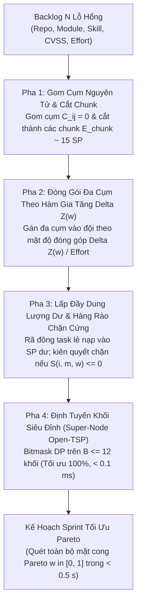

# H-CSM: Hierarchical Capacitated Cluster-Simulate-Match for Agile SecOps Vulnerability Scheduling

Hệ sinh thái thuật toán tối ưu hóa điều độ và phân bổ công việc khắc phục lỗ hổng an ninh mạng đa mục tiêu trong chu kỳ Sprint Agile (**Bi-Objective Agile SecOps Vulnerability Scheduling**).

Bài toán được mô hình hóa theo dạng Đa ba-lô đa kỹ năng (**Multi-Team Multi-Skill Knapsack**) kết hợp Định tuyến tối ưu giảm chi phí chuyển đổi ngữ cảnh (**Context-Switch Routing / Open-TSP**). Thuật toán đề xuất **H-CSM** khai thác cấu trúc phân cấp tự nhiên của mã nguồn (Repo $\to$ Module $\to$ Skill) nhằm tối ưu hóa đồng thời Lợi ích an ninh ($f_1$) và Chi phí chuyển đổi ngữ cảnh ($f_2$) với thời gian thực thi mili-giây.

---

## 1. Mô Hình Toán Học Hình Thức (MO-MILP Formulation)

### 1.1. Các Chỉ Số Cốt Lõi
1. **Điểm Lợi Ích Khắc Phục Lỗ Hổng (Dynamic Mitigation Utility — $u_i$)**:
   $$u_i = r_i + \alpha \cdot (\tau - \text{disc}_i) + M_{\text{penalty}} \cdot \mathbb{I}(\tau \ge \text{dead}_i)$$
   - $r_i \in [0.0, 10.0]$: Điểm rủi ro kỹ thuật CVSS gốc.
   - $\alpha = 0.5$: Hệ số già hóa rủi ro tồn lưu theo thời gian qua các sprint chưa vá.
   - $M_{\text{penalty}} = 50.0$: Mức phạt leo thang khi sprint hiện tại $\tau$ đã chạm hoặc vượt quá hạn chót SLA $\text{dead}_i$.

2. **Khoảng Cách Ngữ Cảnh Tác Vụ (Context Switch Distance — $C_{ij} \in [0.0, 1.0]$)**:
   $$C_{ij} = w_{\text{repo}} \cdot \mathbb{I}(\text{repo}_i \neq \text{repo}_j) + w_{\text{mod}} \cdot \mathbb{I}(\text{mod}_i \neq \text{mod}_j) + w_{\text{skill}} \cdot \mathbb{I}(\text{skill}_i \neq \text{skill}_j)$$
   - $w_{\text{repo}} = 0.5$: Chi phí chuyển đổi repository mã nguồn (IDE context reload).
   - $w_{\text{mod}} = 0.3$: Chi phí chuyển đổi phân hệ / microservice module.
   - $w_{\text{skill}} = 0.2$: Chi phí chuyển đổi nhóm kỹ năng an toàn OWASP Top-10.
   - Tổng trọng số: $0.5 + 0.3 + 0.2 = 1.0$. $C_{ij} = 0$ khi và chỉ khi hai tác vụ cùng kho, cùng phân hệ và cùng nhóm kỹ năng.

### 1.2. Hàm Mục Tiêu Kép Chuẩn Hóa Pareto (Normalized Weighted Sum)
- **Mục tiêu 1 (Cực đại hóa Lợi ích An ninh)**:
  $$\max f_1 = \sum_{t \in T} \sum_{i \in \mathcal{V}} u_i \cdot x_{it}$$
- **Mục tiêu 2 (Cực tiểu hóa Tổng Chi phí Chuyển đổi Ngữ cảnh)**:
  $$\min f_2 = \sum_{t \in T} \sum_{i \in \mathcal{V}} \sum_{j \in \mathcal{V}, j \neq i} C_{ij} \cdot z_{ijt}$$
- **Hàm vô hướng hóa chuẩn hóa**:
  $$\max Z(w) = w \cdot \frac{f_1 - f_1^{\min}}{f_1^{\max} - f_1^{\min}} - (1 - w) \cdot \frac{f_2 - f_2^{\min}}{f_2^{\max} - f_2^{\min}} \quad \text{với } w \in [0.0, 1.0]$$

---

## 2. Thuật Toán Đề Xuất H-CSM (4 Pha Chuyên Biệt)



1. **Pha 1 (Atomic Coarsening & Capacitated Chunking)**:
   - Gom các task có cùng `(repo, module, skill)` vào một cụm nguyên tử ($C_{ij} = 0$).
   - Cắt cụm thành các chunk nhỏ vừa vặn $E_{\text{chunk}} = 0.5 \cdot \min(\text{cap}_m) = 15\text{ SP}$ theo mật độ $\rho_i = u_i / e_i$ giảm dần.
2. **Pha 2 (Multi-Cluster Packing with Global Objective Delta Z)**:
   - Tính lượng tăng hàm mục tiêu toàn cục $\Delta Z(w)$:
     $$\text{Gain}(B_k, m, w) = w \cdot \frac{U(B_k)}{f_1^{\max}} - (1 - w) \cdot \frac{\Delta C(B_k, \mathcal{A}_m)}{f_2^{\max}}$$
   - Đóng gói theo mật độ $\text{Density} = \text{Gain} / E(B_k)$ thỏa mãn kỹ năng và dung lượng.
3. **Pha 3 (Residual Backfill & Hard Guardrail)**:
   - Rã đông task lẻ để nạp vào dung lượng dư ($2 - 8\text{ SP}$).
   - **Hàng rào chặn cứng**: Chỉ nạp task $i$ vào đội $m$ nếu $S(i, m, w) = \frac{\Delta Z}{e_i} > 0$. Nếu $S \le 0$, kiên quyết từ chối nạp để bảo vệ ngữ cảnh lập trình viên.
4. **Pha 4 (Super-Node Block-Level Open-TSP)**:
   - Gom các task cùng ngữ cảnh thành $B$ khối siêu đỉnh ($B \le 12$).
   - Chạy **Quy hoạch động Bitmask DP** ($O(2^B \cdot B^2)$) tìm chuỗi tối ưu 100% trong $< 0.1\text{ ms}$.

---

## 3. Danh Sách Các Baselines Đối Chuẩn

1. **`Greedy-CVSS` (Baseline 1 — Thực tế doanh nghiệp Jira/Scrum)**:
   - Sắp xếp backlog theo mật độ lợi ích $\rho_i = u_i / e_i$ giảm dần. Bốc việc tuần tự theo dung lượng và kỹ năng, mù ngữ cảnh chuyển đổi.
2. **`OR-Tools CP-SAT` (Baseline 2 — Chuẩn vàng lý thuyết MO-MILP)**:
   - Bộ giải Exact Constraint Programming kết hợp SAT của Google với biến MTZ subtour elimination.
3. **`OR-Tools Routing GLS` (Baseline 3 — Metaheuristic công nghiệp đỉnh cao)**:
   - Giải bài toán Capacitated Team Orienteering Problem (CTOP) bằng `PARALLEL_CHEAPEST_INSERTION` và `GUIDED_LOCAL_SEARCH`.

---

## 4. Hướng Dẫn Sử Dụng & CLI Điều Khiển

### Cài Đặt Môi Trường
```bash
uv sync
```

### Các Lệnh Thực Nghiệm
```bash
# 1. Chạy Kế hoạch A: Static Snapshot Benchmark (3 kịch bản x 5 instances x 3 weights)
python main.py static

# 2. Chạy Kế hoạch B: Multi-Sprint Rolling Simulation (8 Sprints x 5 seeds x 4 solvers)
python main.py rolling

# 3. Kiểm toán chi tiết 1 instance với Phase Logger
python main.py inspect --scenario small_40 --instance 1 --solver proposed --detailed

# 4. Xuất toàn bộ biểu đồ (4 Line Charts qua 8 Sprints & Pareto Fronts)
python main.py plot

# 5. Chạy toàn bộ kiểm thử Unit Tests
python main.py test
```

---

## 5. Cấu Trúc Thư Mục Chuẩn

```text
prj3-algo-no-dag/
├── dataset/
│   ├── benchmark/                # 15 file JSON instances chuẩn (small, medium, large)
│   └── benchmark_loader.py       # Loader dữ liệu benchmark chuẩn
├── src/
│   ├── models.py                 # Task, Team, ScheduleResult, SprintPlan (chuẩn disc_i, dead_i)
│   ├── bounds.py                 # compute_static_bounds (f1_max, f2_max chuẩn toán học)
│   ├── metrics.py                # compute_context_distance, compute_utility, evaluate_plan, wilcoxon
│   └── solvers/
│       ├── base.py               # Abstract BaseSolver
│       ├── greedy_cvss.py        # Baseline 1: Greedy-CVSS
│       ├── cpsat_exact.py        # Baseline 2: OR-Tools CP-SAT MO-MILP with MTZ
│       ├── ortools_routing.py    # Baseline 3: OR-Tools Routing GLS
│       └── proposed_hcsm/        # Thuật toán đề xuất H-CSM (4 Pha Chuẩn)
│           ├── coarsening.py     # Pha 1: Atomic coarsening & chunking E_chunk = 15 SP
│           ├── packing.py        # Pha 2: Multi-cluster packing với Delta Z(w) / Effort
│           ├── backfill.py       # Pha 3: Residual backfill & Hard Guardrail S(i, m, w) > 0
│           ├── block_tsp.py      # Pha 4: Super-node Bitmask DP (B <= 12)
│           └── solver.py         # Solver tổng hợp với cơ chế PhaseLogger
├── scripts/
│   ├── run_benchmark_static.py   # Kế hoạch A: 5 instances x 3 scenarios x 3 weights
│   ├── run_benchmark_rolling.py  # Kế hoạch B: Mô phỏng 8 Sprints x 5 seeds x 4 solvers
│   └── plot_benchmarks.py        # Xuất đồ thị: 4 Line Charts & Pareto Fronts
├── outputs/
│   ├── static/                   # Kết quả Kế hoạch A: raw_runs.jsonl, summary_metrics.csv
│   │   └── assignments/          # Chi tiết phân bổ task, thứ tự chuỗi công việc từng run
│   ├── rolling/                  # Kết quả Kế hoạch B: rolling_scorecard.csv, rolling_runs.jsonl
│   │   └── traces/               # Chi tiết từng Sprint: TVE, Breaches, phân bổ từng đội
│   └── figures/                  # 4 Line Charts PNG & Pareto Front PNGs
├── tests/
│   ├── test_models_metrics.py    # Test models, C_ij, static bounds, Wilcoxon
│   ├── test_hcsm.py              # Test 4 pha H-CSM, Guardrail, Bitmask DP
│   └── test_baselines.py         # Test CP-SAT, Routing GLS, Greedy
├── main.py                       # CLI điều khiển tập trung
└── README.md
```
