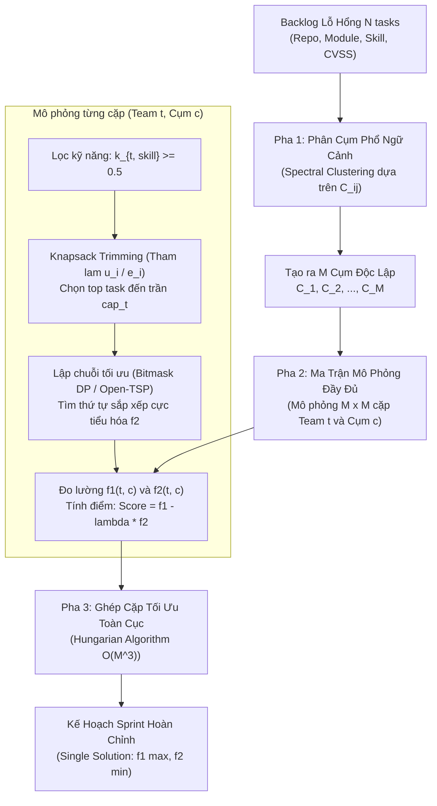
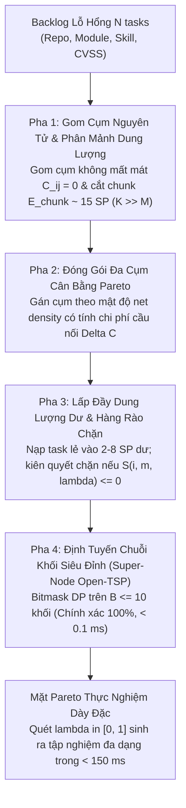

# Thiết Kế Thuật Toán Đề Xuất (H-CSM & Baseline CSM — No-DAG Formulation)

> **Mục tiêu**: Điều phối kế hoạch vá lỗ hổng an ninh mạng đa đội, đa kỹ năng trong một Sprint (No-DAG DevSecOps).  
> **Cấu trúc tài liệu**:
> - **Phần I**: Thiết kế Baseline trước đó — Thuật toán CSM cũ (Spectral Clustering + Hungarian Matching).
> - **Phần II**: Phân tích các điểm nghẽn lý thuyết & thực nghiệm của CSM cũ.
> - **Phần III**: Thiết kế thuật toán đề xuất — H-CSM (Hierarchical Capacitated Cluster-Simulate-Match).

---

# PHẦN I: THIẾT KẾ BASELINE — THUẬT TOÁN CSM CŨ (SPECTRAL + HUNGARIAN)

### 1. Kiến Trúc Thuật Toán CSM Cũ

### 2. Quy Trình Chi Tiết Các Pha

1. **Pha 1 (Phân cụm phổ ngữ cảnh)**:
   - Tính ma trận khoảng cách ngữ cảnh:
     $$C_{ij} = 0.5 \cdot \mathbb{I}(\text{repo}_i \neq \text{repo}_j) + 0.3 \cdot \mathbb{I}(\text{mod}_i \neq \text{mod}_j) + 0.2 \cdot \mathbb{I}(\text{skill}_i \neq \text{skill}_j)$$
   - Xây dựng ma trận tương đồng RBF: $A_{ij} = \exp(-C_{ij}^2 / 2\sigma^2)$.
   - Phân cụm phổ (Spectral Clustering) trên Laplacian chuẩn hóa để chia backlog thành đúng $K = M$ cụm.
2. **Pha 2 (Mô phỏng ma trận $M \times M$ & Knapsack)**:
   - Với mỗi cặp (Team $t$, Cụm $c$): Lọc task đạt ngưỡng kỹ năng ($k_{t, \text{skill}} \ge 0.5$).
   - Giải 0-1 Knapsack tham lam theo mật độ lợi ích $\rho_i = u_i / e_i$ cho đến khi chạm trần dung lượng $\text{cap}_t$.
   - Giải Open-TSP bằng Bitmask DP trên tập task được giữ lại để tính chi phí chuyển đổi ngữ cảnh $f_2(t, c)$.
   - Tính điểm vô hướng hóa: $\text{Score}(t, c) = f_1(t, c) - \lambda \cdot f_2(t, c)$.
3. **Pha 3 (Hungarian Matching)**:
   - Giải bài toán gán cặp lưỡng phân cực đại trọng số $1-1$ trên ma trận $M \times M$ bằng thuật toán Hungarian ($O(M^3)$) để đưa ra kế hoạch phân bổ sprint.

---

# PHẦN II: CÁC ĐIỂM NGHẼN CỦA CSM CŨ

1. **Lệch pha hình học (Geometric Mismatch)**:
   - Hàm khoảng cách $C_{ij}$ có cấu trúc rời rạc 3 cấp phân cấp (Repo $\to$ Module $\to$ Skill). Các task cùng repo, module, skill có $C_{ij} = 0$ tuyệt đối.
   - Việc chiếu qua ma trận Gauss $A_{ij}$ rồi tính phân rã trị riêng ($O(N^3)$) vừa tốn kém tài nguyên vừa làm mờ ranh giới module tự nhiên.
2. **Mù dung lượng (Capacity-Blind Size Imbalance)**:
   - Spectral Clustering không nhận biết độ nỗ lực $e_i$ hay dung lượng $\text{cap}_m$. Một cụm có thể tích tụ $250\text{ SP}$ trong khi team chỉ có $40\text{ SP}$, dẫn đến việc cắt tỉa ở Pha 2 làm vỡ vụn cấu trúc gắn kết của cụm.
3. **Trói buộc cứng $K = M$**:
   - Ép buộc số cụm đúng bằng số team $M$. Không phản ánh đúng trường hợp số module thực tế nhiều hơn hoặc ít hơn số team.
4. **Lãng phí dung lượng dư (Residual Capacity Gap)**:
   - Thiếu cơ chế nạp bù thông minh, bỏ phí phần dung lượng còn dư sau khi gán cụm.

---

# PHẦN III: THIẾT KẾ ĐỀ XUẤT — THUẬT TOÁN H-CSM

Thuật toán **H-CSM (Hierarchical Capacitated Cluster-Simulate-Match)** thay thế phân cụm phổ bằng gom cụm nguyên tử, phân mảnh dung lượng kiểm soát tải, và đóng gói đa cụm tham lam với tham số Pareto $\lambda \in [0, 1]$.

---

### Pha 1: Gom Cụm Nguyên Tử & Phân Mảnh Dung Lượng (Coarsening & Chunking)

#### Bước 1.1: Gom cụm nguyên tử thuần khiết (Pure Atomic Coarsening)
- Gom tất cả task có cùng bộ ba $(\text{repo}_i, \text{mod}_i, \text{skill}_i)$ vào cùng một **Cụm Nguyên Tử** $B_k$.
- Thuộc tính toán học:
  $$\forall i, j \in B_k \implies C_{ij} = 0$$
  Chi phí chuyển đổi nội bộ trong cụm bằng 0 tuyệt đối ($C_{\text{internal}} = 0$). Không gộp các skill khác nhau ở Pha 1 để bảo toàn tính thuần khiết.
- Sắp xếp các task trong $B_k$ theo mật độ lợi ích giảm dần:
  $$\rho_i = \frac{u_i}{e_i}$$

#### Bước 1.2: Phân mảnh dung lượng (Capacitated Chunking)
- Đặt kích thước chunk chuẩn:
  $$E_{\text{chunk}} = \frac{1}{2} \min_{m} \text{cap}_m$$
- **Nếu cụm to** ($\sum_{i \in B_k} e_i > E_{\text{chunk}}$): Chia tuần tự dọc theo danh sách đã xếp theo $\rho_i$ thành các chunk nhỏ hơn $B_{k,1}, B_{k,2}, \dots$ sao cho mỗi chunk có tổng effort $\approx E_{\text{chunk}}$. Vì cùng $(\text{repo}, \text{mod}, \text{skill})$, chi phí nội bộ của mỗi chunk vẫn là $0$.
- **Nếu cụm nhỏ** ($\sum_{i \in B_k} e_i \le E_{\text{chunk}}$): Giữ nguyên cụm độc lập.
- Kết quả: Sinh ra $K$ cụm nhỏ vừa vặn ($K > M$, thường $K \in [15, 40]$ với $N=500$), tách rời số cụm khỏi số đội và khắc phục triệt để lỗi "mù dung lượng".

---

### Pha 2: Đóng Gói Đa Cụm Cân Bằng Pareto (Regret Multi-Cluster Packing)

#### Bước 2.1: Chuẩn hóa Utility & Giá trị cụm
- Chuẩn hóa utility: $\hat{u}_i = u_i / \max_j u_j \in [0, 1]$.
- Giá trị rủi ro của cụm $B_k$:
  $$V(B_k) = \sum_{i \in B_k} \hat{u}_i$$

#### Bước 2.2: Đóng gói tham lam có tính chi phí cầu nối (Bridge Cost)
- Gọi $\mathcal{A}_m$ là tập hợp các cụm đã gán cho team $m$, và $\text{rem}_m = \text{cap}_m - \sum_{B_q \in \mathcal{A}_m} E_q$ là dung lượng còn lại.
- **Chi phí cầu nối ước lượng**:
  $$\Delta C(B_k, \mathcal{A}_m) = \begin{cases} 0 & \text{nếu } \mathcal{A}_m = \emptyset \\ \min_{B_q \in \mathcal{A}_m} C(B_k, B_q) & \text{nếu } \mathcal{A}_m \neq \emptyset \end{cases}$$
- **Hàm lợi ích ròng biên** dưới trọng số Pareto $\lambda \in [0, 1]$:
  $$\text{Gain}(B_k, m, \lambda) = \lambda \cdot V(B_k) - (1 - \lambda) \cdot \Delta C(B_k, \mathcal{A}_m)$$
- **Quy tắc gán**: Chọn cặp $(B_{k^*}, m^*)$ tối đa hóa tỷ số $\text{Gain}(B_k, m, \lambda) / E_k$, thỏa mãn điều kiện kỹ năng ($k_{m, s_k} \ge 0.5$) và $E_{k^*} \le \text{rem}_{m^*}$. Lặp lại cho đến khi không còn cụm nào vừa dung lượng trống của bất kỳ team nào.

---

### Pha 3: Lấp Đầy Dung Lượng Dư & Hàng Rào Chặn Cứng (Residual Backfill & Guardrail)

Sau khi đóng gói cụm, các team còn dư dung lượng nhỏ lẻ ($2 - 8\text{ SP}$). Ta duyệt tập task lẻ chưa được gán $\mathcal{U}$:

1. **Chi phí chèn biên**:
   $$\Delta C_{i \to m} = \min_{j \in \pi_m} C_{ij}$$
   *(Nếu team $m$ đã có task cùng repo/module/skill $\implies \Delta C_{i \to m} = 0$)*.
2. **Điểm hiệu quả biên Pareto**:
   $$S(i, m, \lambda) = \frac{\lambda \cdot \hat{u}_i - (1 - \lambda) \cdot \Delta C_{i \to m}}{e_i}$$
3. **Hàng rào chặn cứng (Hard Guardrail)**:
   - **Chỉ nạp task $i$ vào team $m$ nếu $S(i, m, \lambda) > 0$.**
   - Khi $\lambda = 1.0$: $(1 - \lambda)\Delta C = 0 \implies S > 0$ cho mọi task, nạp tối đa đến 100% dung lượng.
   - Khi $\lambda < 0.5$: Nếu task lẻ ở repo lạ làm tăng chi phí chuyển đổi cao, $S \le 0 \implies$ Thuật toán kiên quyết từ chối nạp, giữ sạch ngữ cảnh cho team thay vì cố lấp đầy dung lượng bằng các task gây nhiễu.

---

### Pha 4: Lập Chuỗi Open-TSP Mức Khối Siêu Đỉnh (Super-Node Block-Level Open-TSP)

1. **Khái niệm Khối Siêu đỉnh (Super-Node)**:
   - Các task gán cho team $m$ có cùng $(\text{repo}, \text{mod}, \text{skill})$ tạo thành 1 Khối $G_b$.
   - Vì mọi cặp task giữa Khối $A$ và Khối $B$ đều có khoảng cách bằng hằng số $C(A, B) \equiv C_{ij}$, không phụ thuộc vào thứ tự task vào/ra nội bộ.
2. **Bitmask DP trên các Khối**:
   - Số khối trên 1 team $B \le 10$ (thường từ $4 - 8$ khối).
   - Giải Open-TSP chính xác 100% trong $O(2^B \cdot B^2)$ với thời gian thực thi $< 0.1\text{ ms}$.

   - *Dự phòng ($B > 12$)*: Áp dụng Hierarchical TSP (xếp thứ tự các khối cùng repo trước, sau đó xếp thứ tự các repo).

---

## SO SÁNH TỔNG HỢP: CSM CŨ VS. H-CSM MỚI

| Tiêu chí | CSM Cũ (Spectral + Hungarian) | H-CSM Mới (Hierarchical Capacitated CSM) |
| :--- | :--- | :--- |
| **Thuật toán gom cụm** | Phân cụm phổ Gauss ($O(N^3)$) | Gom cụm nguyên tử Hash map ($O(N \log N)$) |
| **Số lượng cụm $K$** | Bị ép cứng $K = M$ | Linh hoạt $K > M$ (tách rời số team) |
| **Kiểm soát dung lượng** | Mù dung lượng (Cụm 300 SP, tỉa nát cụm) | Khống chế bằng $E_{\text{chunk}}$, không bao giờ vỡ cụm |
| **Phương pháp gán** | Hungarian $1-1$ trên ma trận $M \times M$ | Greedy Packing đa cụm có xét Chi phí cầu nối $\Delta C$ |
| **Tận dụng dung lượng dư** | Không có (bỏ phí 10 - 20% capacity) | Pha 3.5 Backfill với Hard Guardrail $S(i, m, \lambda) > 0$ |
| **Lập chuỗi Open-TSP** | DP trên từng task lẻ (fallback tham lam nếu $n > 14$) | Super-Node Block-Level DP ($B \le 10$, chính xác 100%) |
| **Thời gian chạy ($N=500$)** | $\sim 450\text{ ms}$ (cho 1 nghiệm đơn lẻ) | **$\sim 6\text{ ms}$ (cho 1 nghiệm)** |
| **Khảo sát Mặt Pareto** | Kém (chỉ đổi trọng số scalarized Hungarian) | **Quét 21 điểm $\lambda \in [0, 1]$ trong $< 150\text{ ms}$** |

